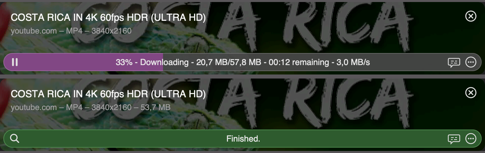

<p align="center"></p>

# Video Downloader for Tinycast

Download videos from YouTube, 𝕏, Twitch, Instagram, Bilibili and [everything else yt-dlp supports](https://github.com/yt-dlp/yt-dlp/blob/master/supportedsites.md), right from [Tinycast](https://tinycast.dev) on macOS. Progress looks like a Downie download row.



## Features

- **MP4 up to 4K/8K** with a resolution choice (Highest, 1440p, 1080p, 720p), the original format, or MP3 audio.
- **Dubbed audio tracks**: when a YouTube video has dubbed or auto-dubbed audio, pick the language. Defaults to the original.
- **One progress bar per video**: video and audio streams are combined into a single bar with size, speed and time remaining.
- **Pause, resume and stop**, and the download keeps running if you close the command. Reopen it to see progress again.
- **No duplicate downloads**: starting the same video twice shows the running download instead.
- **Browser cookies** for sign-in, age and bot checks, with a **Check Browser Cookies** action (⌘⇧K) that tests them inside Tinycast.
- **Extract Transcript**: copy or save a video's captions as Markdown or text.

## Requirements

- Tinycast Beta 0.10.15-beta.83 or later
- [yt-dlp](https://github.com/yt-dlp/yt-dlp) and [FFmpeg](https://ffmpeg.org), for example with Homebrew:

```bash
brew install yt-dlp ffmpeg
```

## Install

1. Download `video-downloader.zip` from the [latest release](../../releases/latest) and unzip it.
2. In Tinycast, open Settings → Extensions → Install → Add Folder, and choose the unzipped `video-downloader` folder.
3. Optional: set a hotkey for **Download Video** in the same settings page. ⌘⌥D works well.

The release already contains the built extension, so Node.js isn't needed to use it.

## Build from source

```bash
npm install --ignore-scripts
npm run build
```

Or run `Build.command`. For the locked dependency versions: `pnpm install --frozen-lockfile --ignore-scripts && pnpm run build`.

See [TINYCAST-README.md](TINYCAST-README.md) for how everything works, and what was tested.

## Credits

Tinycast edition by [cojonesnaut](https://github.com/cojonesnaut). Based on the [Video Downloader](https://www.raycast.com/vimtor/video-downloader) Raycast extension by vimtor and contributors ([original README](RAYCAST-README.md)). MIT license, see [LICENSE](LICENSE).
